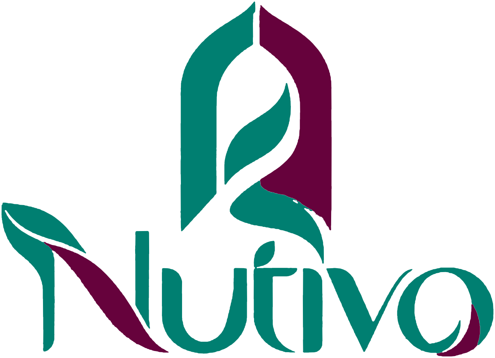
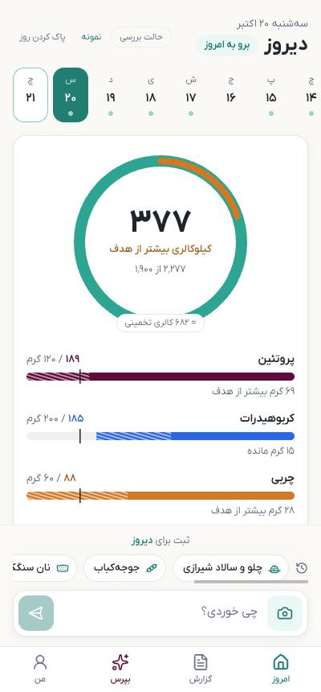
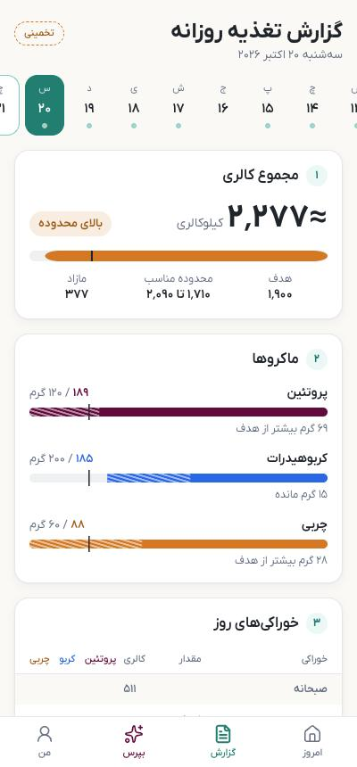
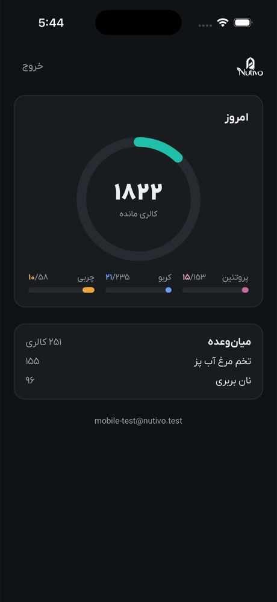
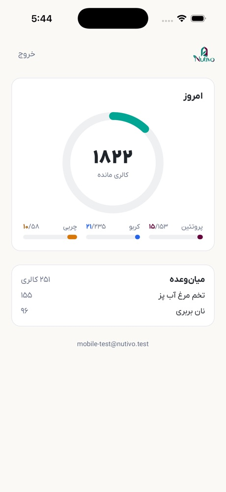
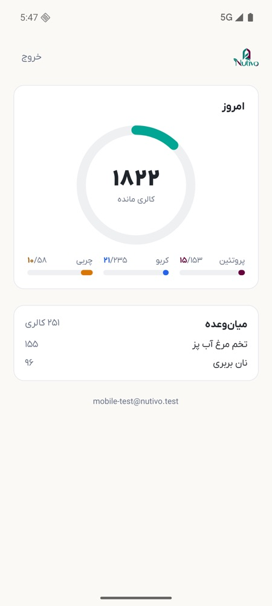

<p align="center">
  <picture>
    <source media="(prefers-color-scheme: dark)" srcset="apps/web/public/brand/nutivo-lockup-white.svg">
    
  </picture>
</p>

<h3 align="center">Eat Smarter. Live Better.</h3>

<p align="center">
  A Persian-first nutrition companion. Log a meal in a sentence or a photo, in Persian, and get real numbers from an Iranian food table, not from a language model.
</p>

<p align="center">
  <a href="#english">English</a> · <a href="#فارسی">فارسی</a>
</p>

<p align="center">
  
  &nbsp;
  
  &nbsp;
  
</p>

---

<a id="english"></a>

## What Nutivo is

Most calorie trackers recognise "rice and chicken". Nutivo knows what two کفگیر of چلو with a tablespoon of oil is.

Nutivo is built for Persian speakers who eat Iranian food at home and mixed food outside, starting with the Persian community in Toronto. You type «دو کفگیر چلو با یه سیخ جوجه» or send a photo of your plate, confirm what Nutivo understood, and the day updates against your goals. In the evening you get a short Persian report on how the day went.

Three rules shape the product:

1. **Numbers come from the database and the engine, never from the model.** Claude only extracts and disambiguates what you ate. Calories and macros come from a hand-reviewed Persian food table (`foods_fa`) with local portion units, then USDA FoodData Central and Open Food Facts.
2. **Confirm before you count.** Every entry is shown to you first; only confirmed items count toward the day. Items read from a photo are marked as estimates, and an unknown quantity triggers one question instead of a guess.
3. **Persian first, done right, not translated.** RTL layout, Persian digits, IRANYekanX type, and food names and units people actually use (کفگیر، کاسه، سیخ).

## Features

- **Log by text or photo**, in Persian or English, with a confirmation card and undo.
- **One-tap repeats** of meals you eat often, such as yesterday's dinner.
- **Today view**: calories ring, protein, carbs and fat against your targets, with estimated values drawn apart from confirmed ones.
- **Day strip**: swipe through previous days, edit or delete meals, log to a past day.
- **«بپرس» (Ask)**: «شام چی بخورم؟» gets a suggestion based on what is left of the day's budget.
- **Nightly report**: the day's facts from the engine, a short analysis written by Claude from those numbers only, and a number guard that rejects any figure the engine did not produce.
- **نوتی (Noti)**: a playful mascot who voices Nutivo's insights. She never comments on weight or body, never guilts, and can be switched off.
- **Telegram bot** ([@NUTIVO_bot](https://t.me/NUTIVO_bot)): onboarding, text and photo logging, the today card, repeats and the nightly report in chat.
- **iOS and Android app** (Expo): email-code sign-in, tabs for today, log, report, ask and «من», meal reminders and a nightly report notification.
- **Admin panel**: users, activity and system log, D1/D7/D30 retention, logging frequency, AI cost, and encrypted API key settings.

## Screenshots

| Web: today | Web: daily report | iOS: today | iOS: dark mode | Android |
|:---:|:---:|:---:|:---:|:---:|
|  |  |  |  |  |

The web screenshots use the sample week from review mode. The mobile screenshots come from an early phase 3 build, before the tab bar.

## How it works

```
input (text | photo | quick repeat)
  → Claude extract_meal (structured JSON, no numbers)
  → resolve each item: foods_fa → USDA → Open Food Facts
  → ask at most one question
  → @nutivo/core calculates grams and macros
  → user confirms
  → Supabase → today view, report, nightly report
```

Nutrition values are frozen on each logged item when you confirm it, so later changes to the food table do not rewrite your history.

## Architecture

A pnpm monorepo. Every surface (web, bot, mobile) is a thin interface over the same core package and the same tables.

| Path | What it is |
|---|---|
| `apps/web` | Next.js 15 (App Router) web app, RTL. Server Actions for logging, the nightly report cron route, the admin panel, and the mobile API at `/api/app/*`. |
| `apps/mobile` | Expo SDK 57 app with Expo Router and Uniwind (Tailwind 4). Calls `/api/app/<action>` with the user's own Supabase token. |
| `apps/bot` | Telegram bot on grammY. Shares the same service layer as the mobile API. |
| `packages/core` | Zod schemas, units, nutrition math, goals, the daily report builder, prompts and نوتی's lines. No dependency on Next or Supabase. |
| `packages/db` | Supabase migrations with row-level security, the Persian food CSV and portion units, the seed validator, demo data. |

## Tech stack

- **Frontend:** Next.js 15, React 19, TypeScript, Tailwind CSS 4, shadcn/ui
- **Mobile:** Expo SDK 57, React Native 0.86, Expo Router, Uniwind
- **Bot:** grammY
- **Data and auth:** Supabase (Postgres, Auth with email codes, Storage for meal photos, RLS)
- **AI:** Claude API with tool use for meal extraction and vision, and for the report text
- **Hosting:** Railway (web app and mobile API), Supabase cloud in `ca-central-1`
- **Type:** IRANYekanX (Persian), Plus Jakarta Sans (English)

## Running locally

You need Node.js, pnpm 10 and Docker. Everything runs against a local Supabase stack in Docker.

```bash
pnpm install
cp apps/web/.env.example apps/web/.env.local   # then fill in the keys
pnpm db:start     # Postgres + Auth + Storage in Docker (ports 56xxx)
pnpm db:demo      # sample users with two weeks of meals
pnpm dev          # web app on http://localhost:3000
```

| Service | URL |
|---|---|
| Web app | http://localhost:3000 |
| Admin panel | http://localhost:3000/admin |
| Supabase Studio | http://127.0.0.1:56323 |
| Mailpit (sign-in emails and codes) | http://127.0.0.1:56324 |

Other commands: `pnpm db:status` shows local keys and URLs, `pnpm db:reset` wipes and re-seeds, `pnpm bot` starts the Telegram bot, `pnpm test` and `pnpm typecheck` run across all packages.

**Mobile app:** copy `apps/mobile/.env.example` to `apps/mobile/.env.local`, keep `pnpm dev` running, then `pnpm --filter @nutivo/mobile ios` or `pnpm --filter @nutivo/mobile android`.

Full guides (in Persian): [docs/LOCAL_DEV.md](docs/LOCAL_DEV.md), [docs/DEPLOY.md](docs/DEPLOY.md), [docs/ARCHITECTURE.md](docs/ARCHITECTURE.md). Product and brand decisions: [PRODUCT.md](PRODUCT.md), the mascot: [docs/MASCOT.md](docs/MASCOT.md).

Secrets never live in the code. Every key is read from environment variables; the `.env.example` files list them with empty values.

## Status

Nutivo is in active development and not yet open to the public.

- **Phase 1, web app:** done. Running on Railway with Supabase cloud.
- **Phase 2, Telegram bot:** done, running locally; hosting it on Railway is next.
- **Phase 3, iOS and Android app:** in progress. Sign-in, logging, today, report, ask, profile, reminders and notifications are built.
- **Next:** the founder uses Nutivo daily for 14 days before anyone else, then a small group of testers. The nightly report cron goes live with the hosted bot.
- **Later:** voice input, barcode scanning, a bilingual UI, and a nutrition reviewer for the Persian food table.

## Food data

The Persian food table in `packages/db/seed/foods_fa.csv` is reviewed by hand, and each row cites its source (mostly USDA SR Legacy) with notes on recipe assumptions. A FigFit import script exists for local, non-commercial testing only; FigFit data is licensed CC BY-NC-SA 4.0, is not part of this repository, and is never used in production.

## License

The code is released under the [MIT License](LICENSE), copyright © 2026 Farjad P.D. The licence does not cover the Nutivo name, logo and نوتی character, or the IRANYekanX font files, which are licensed separately by Fontiran.

## Credits

Built by [Farjad P.D](https://farjadp.com) with Claude Code. Nutrition data from USDA FoodData Central and Open Food Facts. Persian type: IRANYekanX by Fontiran.

---

<a id="فارسی"></a>

<div dir="rtl">

## نوتیوو چیست

بیشتر اپ‌های کالری‌شماری «برنج و مرغ» را می‌شناسند. نوتیوو می‌داند دو کفگیر چلو با یک قاشق روغن یعنی چه.

نوتیوو برای فارسی‌زبان‌هایی ساخته شده که در خانه غذای ایرانی می‌خورند و بیرون هر چیزی، و از جامعه ایرانی تورنتو شروع می‌کند. می‌نویسی «دو کفگیر چلو با یه سیخ جوجه» یا از بشقابت عکس می‌فرستی، چیزی را که نوتیوو فهمیده تأیید می‌کنی و روزت نسبت به هدف‌هایت به‌روز می‌شود. شب هم یک گزارش کوتاه فارسی از روزت می‌گیری.

سه اصل محصول را شکل می‌دهد:

۱. **عددها از دیتابیس و موتور محاسبه می‌آیند، نه از مدل زبانی.** Claude فقط تشخیص می‌دهد چه خورده‌ای. کالری و درشت‌مغذی‌ها از جدول غذاهای ایرانیِ بازبینی‌شده (`foods_fa`) با واحدهای محلی می‌آیند و بعد از USDA و Open Food Facts.

۲. **اول تأیید، بعد شمارش.** هر ورودی اول به خودت نشان داده می‌شود و فقط آیتم‌های تأییدشده در جمع روز حساب می‌شوند. آیتم‌هایی که از عکس خوانده شده‌اند «تخمینی» علامت می‌خورند و اگر مقدار معلوم نباشد، نوتیوو یک سؤال می‌پرسد و حدس نمی‌زند.

۳. **فارسی از اول، درست، نه ترجمه.** چیدمان راست‌به‌چپ، اعداد فارسی، فونت ایران‌یکان و اسم غذاها و واحدهایی که مردم واقعاً به کار می‌برند (کفگیر، کاسه، سیخ).

## امکانات

- **ثبت با متن یا عکس**، به فارسی یا انگلیسی، با کارت تأیید و امکان برگرداندن.
- **تکرار با یک لمس** برای وعده‌هایی که زیاد می‌خوری، مثل شام دیروز.
- **صفحه امروز**: حلقه کالری و نوارهای پروتئین، کربوهیدرات و چربی نسبت به هدف؛ مقدارهای تخمینی از تأییدشده‌ها جدا نمایش داده می‌شوند.
- **نوار روزها**: روزهای قبل را ورق بزن، وعده‌ها را ویرایش یا حذف کن، یا برای روز گذشته ثبت کن.
- **«بپرس»**: به «شام چی بخورم؟» با توجه به باقی‌مانده بودجه امروز پیشنهاد می‌دهد.
- **گزارش شبانه**: واقعیت‌های روز از موتور محاسبه، تحلیل کوتاهی که Claude فقط از روی همان عددها می‌نویسد، و محافظی که هر عددی را که موتور تولید نکرده رد می‌کند.
- **نوتی**: دختربچه‌ای شیطون و بامزه که بینش‌های نوتیوو را می‌گوید. هیچ‌وقت درباره وزن و هیکل حرف نمی‌زند، سرزنش نمی‌کند و می‌شود خاموشش کرد.
- **بات تلگرام** ([‎@NUTIVO_bot‎](https://t.me/NUTIVO_bot)): شروع، ثبت با متن و عکس، کارت امروز، تکرار وعده و گزارش شبانه داخل چت.
- **اپ iOS و اندروید** (Expo): ورود با کد ایمیلی، تب‌های امروز، ثبت، گزارش، بپرس و «من»، یادآوری وعده‌ها و اعلان گزارش شبانه.
- **پنل ادمین**: کاربران، لاگ فعالیت و سیستم، ماندگاری روز ۱ و ۷ و ۳۰، تعداد دفعات ثبت، هزینه هوش مصنوعی و تنظیمات رمزشده کلیدها.

## تصویرها

| وب: امروز | وب: گزارش روزانه | iOS: امروز | iOS: حالت تاریک | اندروید |
|:---:|:---:|:---:|:---:|:---:|
|  |  |  |  |  |

تصویرهای وب از هفته نمونه در حالت بررسی گرفته شده‌اند. تصویرهای موبایل مال نسخه اولیه فاز ۳ و قبل از اضافه شدن نوار تب‌ها هستند.

## چطور کار می‌کند

ورودی (متن، عکس یا تکرار سریع) به ابزار `extract_meal` در Claude می‌رود و خروجی‌اش یک JSON ساختاریافته بدون هیچ عددی است. هر آیتم به ترتیب در `foods_fa`، USDA و Open Food Facts پیدا می‌شود، اگر لازم باشد حداکثر یک سؤال پرسیده می‌شود، `@nutivo/core` گرم و درشت‌مغذی‌ها را حساب می‌کند و بعد از تأیید کاربر همه‌چیز در Supabase ذخیره می‌شود.

ارزش غذایی هر آیتم موقع تأیید روی همان آیتم ثابت می‌شود؛ پس اگر جدول غذاها بعداً عوض شود، تاریخچه‌ات دست نمی‌خورد.

## معماری

یک مونوریپوی pnpm. وب، بات و موبایل هر سه رابط‌های نازکی روی یک پکیج مشترک و همان جدول‌ها هستند.

| مسیر | چیست |
|---|---|
| `apps/web` | وب‌اپ Next.js 15 راست‌به‌چپ؛ ثبت با Server Actions، مسیر کرون گزارش شبانه، پنل ادمین و API موبایل در `/api/app/*` |
| `apps/mobile` | اپ Expo SDK 57 با Expo Router و Uniwind؛ با توکن Supabase خود کاربر `/api/app/<action>` را صدا می‌زند |
| `apps/bot` | بات تلگرام با grammY که همان لایه سرویسِ API موبایل را به کار می‌برد |
| `packages/core` | اسکیماهای zod، واحدها، محاسبه تغذیه، هدف‌ها، سازنده گزارش روزانه، پرامپت‌ها و جمله‌های نوتی؛ بدون وابستگی به Next یا Supabase |
| `packages/db` | مهاجرت‌های Supabase با RLS، فایل CSV غذاهای ایرانی و واحدها، اعتبارسنج seed و داده نمونه |

## فناوری‌ها

- **رابط وب:** Next.js 15، React 19، TypeScript، Tailwind CSS 4، shadcn/ui
- **موبایل:** Expo SDK 57، React Native 0.86، Expo Router، Uniwind
- **بات:** grammY
- **داده و ورود:** Supabase (Postgres، ورود با کد ایمیلی، Storage برای عکس وعده‌ها، RLS)
- **هوش مصنوعی:** Claude API با tool use برای تشخیص وعده از متن و عکس و نوشتن متن گزارش
- **میزبانی:** Railway برای وب‌اپ و API موبایل، Supabase ابری در منطقه `ca-central-1`
- **فونت:** ایران‌یکان برای فارسی، Plus Jakarta Sans برای انگلیسی

## اجرای محلی

به Node.js، pnpm نسخه ۱۰ و Docker نیاز داری. همه‌چیز روی Supabase محلی داخل Docker اجرا می‌شود. دستورها در بخش انگلیسی بالا آمده‌اند و راهنمای کامل در [docs/LOCAL_DEV.md](docs/LOCAL_DEV.md) است. برای استقرار [docs/DEPLOY.md](docs/DEPLOY.md) و برای جزئیات فنی [docs/ARCHITECTURE.md](docs/ARCHITECTURE.md) را ببین.

هیچ کلید محرمانه‌ای داخل کد نیست. همه کلیدها از متغیرهای محیطی خوانده می‌شوند و فایل‌های `.env.example` فهرستشان را با مقدار خالی دارند.

## وضعیت

نوتیوو در حال ساخت است و هنوز برای عموم باز نشده.

- **فاز ۱، وب‌اپ:** تمام شده و روی Railway با Supabase ابری اجرا می‌شود.
- **فاز ۲، بات تلگرام:** تمام شده و فعلاً محلی اجرا می‌شود؛ قدم بعدی میزبانی‌اش روی Railway است.
- **فاز ۳، اپ iOS و اندروید:** در حال ساخت. ورود، ثبت، امروز، گزارش، بپرس، پروفایل، یادآوری‌ها و اعلان‌ها آماده‌اند.
- **بعدی:** بنیان‌گذار ۱۴ روز هر روز از نوتیوو استفاده می‌کند و بعد گروه کوچکی از تسترها. کرون گزارش شبانه همراه با بات میزبانی‌شده راه می‌افتد.
- **بعدتر:** ثبت با صدا، اسکن بارکد، رابط دوزبانه و یک کارشناس تغذیه برای بازبینی جدول غذاهای ایرانی.

## داده غذاها

جدول غذاهای ایرانی در `packages/db/seed/foods_fa.csv` دستی بازبینی شده و هر ردیف منبعش را (بیشتر USDA SR Legacy) با یادداشت فرض‌های دستور پخت آورده است. یک اسکریپت برای وارد کردن FigFit هست که فقط برای تست محلی و غیرتجاری است؛ داده FigFit مجوز CC BY-NC-SA 4.0 دارد، داخل این مخزن نیست و هیچ‌وقت در production استفاده نمی‌شود.

## مجوز

کد با [مجوز MIT](LICENSE) منتشر شده است؛ حق نشر ۲۰۲۶ برای فرجاد پ.د. این مجوز شامل نام و لوگوی نوتیوو، شخصیت نوتی و فایل‌های فونت ایران‌یکان نمی‌شود؛ مجوز فونت جداگانه از فونت‌ایران است.

## سازندگان

ساخته [فرجاد پ.د](https://farjadp.com) با Claude Code. داده تغذیه از USDA FoodData Central و Open Food Facts. فونت فارسی: ایران‌یکان از فونت‌ایران.

</div>
